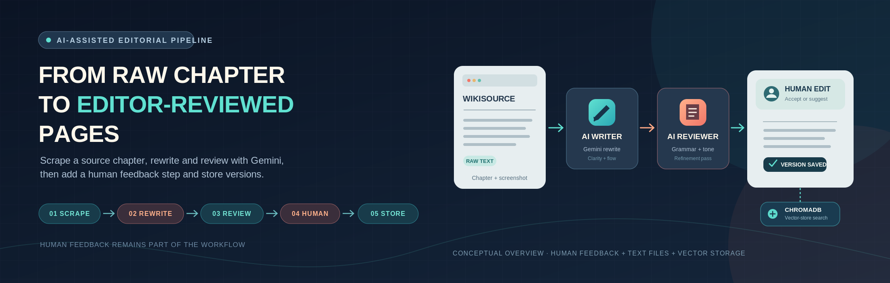
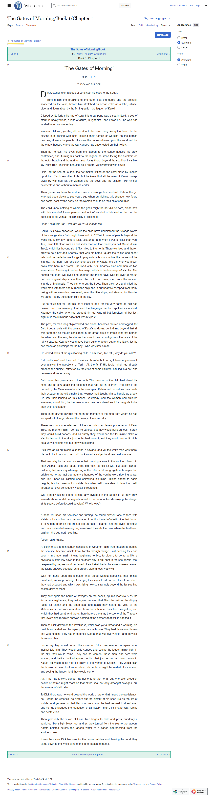

<p align="center">
  
</p>

# Automated Book Publication Workflow

[](https://www.python.org/)
[](https://playwright.dev/)
[](https://ai.google.dev/gemini-api)
[](https://www.trychroma.com/)
[](https://pypi.org/project/python-dotenv/)

A smart, AI-driven content pipeline that simulates the real-world publishing workflow — automating content scraping, intelligent rewriting, human-in-the-loop editing, and versioned storage of book chapters.

Developed as part of the AI Internship assignment for **Softnerve Technology**.

---

## 🚀 Key Features

- 🔍 **Web Scraping & Screenshots** — Automatically extracts book chapters and captures visual snapshots from [Wikisource](https://en.wikisource.org/wiki/The_Gates_of_Morning/Book_1/Chapter_1) using `Playwright`.
- ✍️ **AI-Powered Writing & Reviewing** — Uses **Google Gemini API** to rewrite (spin) chapter text for clarity and engagement, followed by grammar and tone refinement via an AI reviewer.
- 🧠 **Human-in-the-Loop Interaction** — Incorporates suggestions from human writers/editors after each AI pass to simulate a multi-iteration editorial process.
- 🗃️ **Versioned Storage & Search** — Saves every stage (original, AI-written, reviewed, human suggestions) and stores final versions in **ChromaDB**, with a placeholder RL-based search module for future intelligent version retrieval.

---

## 🛠️ Tech Stack

| Tool | Purpose |
|---|---|
|  Python | Core scripting language |
|  `playwright` | Browser automation, page text extraction, and screenshots |
|  Gemini API (`google-generativeai`) | AI writing and review agents (legacy SDK/model in current code) |
|  `chromadb` | Store and query a chapter version |
|  `python-dotenv` | Load the API key from `.env` |

---

## 📁 Project Structure

```
book_publication_workflow/
├── ai_agents/
│   ├── ai_writer.py         # Gemini-based rewriting agent
│   ├── ai_reviewer.py       # Gemini-based review/refinement agent
│   └── human_in_loop.py     # CLI human feedback loop
├── scraping/
│   └── scraper.py           # Playwright scraper + screenshot capture
├── storage/
│   └── chromadb_utils.py    # ChromaDB store/search functions
├── rl_search/
│   └── rl_search.py         # Placeholder for RL-based version retrieval
├── data/                    # Pipeline outputs (spun, reviewed, final versions)
├── screenshots/              # Scraped page screenshots
├── main.py                   # Orchestrates the full pipeline
├── requirements.txt
└── .env.example
```

---

## 🔄 How It Works

1. **Scraping** — Fetches raw text and a screenshot of the source chapter page.
2. **AI Writer Agent** — Rewrites the content using Gemini.
3. **AI Reviewer Agent** — Refines grammar, tone, and structure for publication-readiness.
4. **Human-in-the-Loop** — Prompts for feedback/suggestions via CLI after the AI passes.
5. **Versioned Storage** — Stores the final version in ChromaDB and saves each stage as a `.txt` file in `data/`.

---

---

<details>
  <summary>View the captured source-page screenshot</summary>
  <p align="center">
    
  </p>
</details>

---

## ⚙️ Setup

### Prerequisites
- Python 3.8+
- A Google Gemini API key ([get one here](https://ai.google.dev/))

### Installation
```bash
git clone https://github.com/AvinabhDutta-Dev/book-publication-workflow.git
cd book-publication-workflow
pip install -r requirements.txt
playwright install
```

### Configure environment
```bash
cp .env.example .env
# then edit .env and add your GEMINI_API_KEY
```

---

## ▶️ Running

```bash
python main.py
```

You'll be prompted in the terminal to provide feedback after the AI writes and reviews the chapter — press Enter to accept as-is, or type a suggestion.

### 📁 Output Files (generated in `data/` and `screenshots/`)

| File | Description |
|---|---|
| `spun_chapter.txt` | AI-rewritten version |
| `reviewed_chapter.txt` | AI-refined version |
| `suggestions.txt` | Logged human feedback |
| `final_chapter.txt` | Combined original + spun + reviewed + human suggestion |
| `chapter1.png` | Screenshot of the scraped source page |

---

## 📦 Requirements

`playwright`, `google-generativeai`, `chromadb`, `python-dotenv`

---

## 🔮 Future Scope

- 🌐 Auto-translate chapters using multilingual mode
- 📑 Generate summaries and titles with LLM agents
- 🗨️ Collaborative feedback (Google Docs-style)
- 🧠 Fully implement RL-powered search over ChromaDB (currently a placeholder)

---

## 📝 Notes

- Requires a valid `GEMINI_API_KEY` set in `.env` — the pipeline will not run without it.
- `playwright install` must be run once after `pip install` to download the required browser binaries.
- The current `rl_search.py` is a placeholder that simply calls ChromaDB's search — genuine reinforcement-learning-based ranking is planned future work, not yet implemented.

---

## License & Attribution

This project is licensed under the [Apache License 2.0](LICENSE).

You are welcome to use, modify, and redistribute this project
in accordance with the terms of the license.

## Acknowledgements

Thanks to the Softnerve team for designing an assignment that combines AI, automation, and editorial workflow design.
