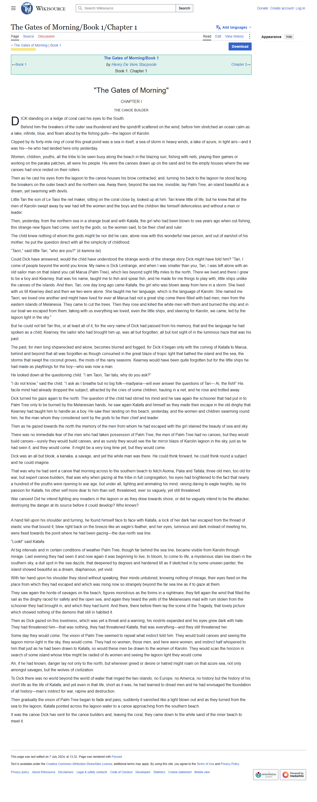

<p align="center">
  
</p>

# Automated Book Publication Workflow

[](https://www.python.org/)
[](https://playwright.dev/)
[](https://ai.google.dev/gemini-api)
[](https://www.trychroma.com/)
[](https://pypi.org/project/python-dotenv/)

A smart, AI-driven content pipeline that simulates the real-world publishing workflow — automating content scraping, intelligent rewriting, human-in-the-loop editing, and versioned storage of book chapters.

Developed as part of the AI Internship assignment for **Softnerve Technology**.

---

## 🚀 Key Features

- 🔍 **Web Scraping & Screenshots** — Automatically extracts book chapters and captures visual snapshots from [Wikisource](https://en.wikisource.org/wiki/The_Gates_of_Morning/Book_1/Chapter_1) using `Playwright`.
- ✍️ **AI-Powered Writing & Reviewing** — Uses the **Google Gemini API** to rewrite (spin) the full chapter for clarity and engagement, followed by grammar and tone refinement via an AI reviewer.
- 🧠 **Human-in-the-Loop Interaction** — Your suggestions are sent back to the AI reviewer, which returns a revised chapter. Repeat for up to 3 rounds (configurable) to simulate a multi-iteration editorial process.
- 🗃️ **Versioned Storage & Search** — Saves every stage as a text file and stores the spun, reviewed, and final versions in a persistent **ChromaDB** database (`storage/chroma_db/`), with a placeholder RL-based search module for future intelligent version retrieval.

---

## 🛠️ Tech Stack

| Tool | Purpose |
|---|---|
|  Python | Core scripting language |
|  `playwright` | Browser automation, page text extraction, and screenshots |
|  Gemini API (`google-genai`) | AI writing and review agents |
|  `chromadb` | Persistent storage for chapter versions |
|  `python-dotenv` | Load the API key from `.env` |

---

## 📁 Project Structure

```
book-publication-workflow/
├── ai_agents/
│   ├── gemini_client.py     # Shared google-genai wrapper (retries, clear errors)
│   ├── ai_writer.py         # Gemini-based rewriting agent
│   ├── ai_reviewer.py       # Gemini-based review agent + applies human feedback
│   └── human_in_loop.py     # CLI human feedback loop
├── scraping/
│   └── scraper.py           # Playwright scraper + screenshot capture
├── storage/
│   └── chromadb_utils.py    # Persistent ChromaDB store/search functions
├── rl_search/
│   └── rl_search.py         # Placeholder for RL-based version retrieval
├── tests/
│   └── test_pipeline.py     # Offline tests (no API key or network needed)
├── data/                    # Pipeline outputs (original, spun, reviewed, final versions)
├── screenshots/             # Scraped page screenshots
├── config.py                # Paths, default chapter URL, Gemini model name
├── main.py                  # Orchestrates the full pipeline
├── requirements.txt
└── .env.example
```

---

## 🔄 How It Works

1. **Scraping** — Fetches the text and a screenshot of the source chapter page (any chapter URL via `--url`).
2. **AI Writer Agent** — Rewrites the full chapter using Gemini.
3. **AI Reviewer Agent** — Refines grammar, tone, and structure for publication-readiness.
4. **Human-in-the-Loop** — Shows the chapter and asks for suggestions. Each suggestion goes back to the AI reviewer, which returns a revised chapter. Press Enter to accept.
5. **Versioned Storage** — Stores the spun, reviewed, and final versions in ChromaDB and saves each stage as a `.txt` file in `data/`.

---

<details>
  <summary>View the captured source-page screenshot</summary>
  <p align="center">
    
  </p>
</details>

---

## ⚙️ Setup

### Prerequisites
- Python 3.10+
- A Google Gemini API key ([get one here](https://aistudio.google.com/apikey))

### Installation
```bash
git clone https://github.com/AvinabhDutta-Dev/book-publication-workflow.git
cd book-publication-workflow
python -m venv .venv
source .venv/bin/activate        # Windows (Git Bash): source .venv/Scripts/activate
                                 # Windows (Command Prompt): .venv\Scripts\activate
pip install -r requirements.txt
playwright install chromium      # fresh Linux machine: playwright install --with-deps chromium
```

### Configure environment
```bash
cp .env.example .env             # Windows (Command Prompt): copy .env.example .env
# then edit .env and replace your_api_key_here with your GEMINI_API_KEY
```
`.env` is listed in `.gitignore`, so your key is not committed.

---

## ▶️ Running

```bash
python main.py
```

You'll be prompted in the terminal to provide feedback after the AI writes and reviews the chapter. Press Enter to accept as-is, or type a suggestion. It is sent to Gemini and you get a revised chapter back.

Options:

```bash
python main.py --url "<another chapter page>"   # choose a different chapter
python main.py --non-interactive                # skip the human feedback step
python main.py --max-rounds 5                   # allow more feedback rounds (default 3)
```

The first run downloads ChromaDB's default embedding model (about 80 MB), so it needs an internet connection at that point.

### 📁 Output Files (generated in `data/` and `screenshots/`)

| File | Description |
|---|---|
| `data/original_chapter.txt` | Scraped text |
| `data/spun_chapter.txt` | AI-rewritten version |
| `data/reviewed_chapter.txt` | AI-refined version |
| `data/suggestions.txt` | Logged human feedback, timestamped (appended on each run) |
| `data/final_chapter.txt` | Original, spun, reviewed, and final versions in one file |
| `screenshots/chapter.png` | Screenshot of the scraped source page |
| `storage/chroma_db/` | ChromaDB database (not committed) |

Apart from `suggestions.txt` and the database, these files are overwritten on every run. ChromaDB keeps one set of versions per run, labelled with a UTC timestamp.

---

## 📦 Requirements

`playwright`, `google-genai`, `chromadb`, `python-dotenv`

---

## 🔮 Future Scope

- 🌐 Auto-translate chapters using multilingual mode
- 📑 Generate summaries and titles with LLM agents
- 🗨️ Collaborative feedback (Google Docs-style)
- 🧠 Fully implement RL-powered search over ChromaDB (currently a placeholder)

---

## 📝 Notes

- Requires a valid `GEMINI_API_KEY` set in `.env`. The pipeline checks for it before doing anything else.
- `playwright install chromium` must be run once after `pip install` to download the browser.
- The default model is `gemini-3.8-flash`. Google retires Gemini models every few months, so if you see a "model not found" error, set `GEMINI_MODEL` in `.env` to a current model from the [model list](https://ai.google.dev/gemini-api/docs/models). `gemini-flash-latest` follows Google's moving alias, so it needs no edits, but results can change when the alias moves.
- The current `rl_search.py` is a placeholder that simply calls ChromaDB's search. Reinforcement-learning-based ranking is planned future work, and nothing in the pipeline queries the stored versions yet.

### Known limitations

- **Long chapters.** The whole chapter is sent to Gemini in one request per step. Gemini's output limit is about 65,000 tokens, so a very long chapter fails with a clear error instead of being silently cut off.
- **Scraper is tuned for Wikisource.** It reads the `#mw-content-text` element. On other sites it falls back to all text on the page, which can include menus and footers.
- **Feedback is applied by the model.** Nothing checks that Gemini followed your suggestion, and each round re-sends the whole chapter.
- **One chapter per run.** There is no batch mode for a whole book.

### Tests

The tests use stand-ins for Gemini and the browser, so they need no API key or network:

```bash
python -m unittest discover -s tests -v
```

### Troubleshooting

| Problem | Fix |
|---|---|
| `GEMINI_API_KEY is not set` | Create `.env` from `.env.example` and paste your key. |
| `Gemini model '...' was not found` | Set `GEMINI_MODEL` in `.env` (see above). |
| `Executable doesn't exist ... chromium` | Run `playwright install chromium`. |
| 429 errors | You hit the free-tier rate limit. The pipeline retries a few times; otherwise wait and rerun. |

---

## 🤝 Contributing

Contributions are welcome! You can help improve the workflow,
fix bugs, enhance documentation, or suggest new features.

- Read the [Contributing Guide](CONTRIBUTING.md).
- Browse [open issues](https://github.com/AvinabhDutta-Dev/book-publication-workflow/issues).
- Report a bug or propose an improvement by opening an issue.

For substantial changes, please discuss the idea in an issue before
submitting a pull request.

---

## License & Attribution

This project is licensed under the [Apache License 2.0](LICENSE).

You are welcome to use, modify, and redistribute this project
in accordance with the terms of the license.

## Acknowledgements

Thanks to the Softnerve team for designing an assignment that combines AI, automation, and editorial workflow design.
